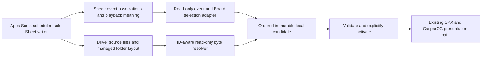

# Apps Script media library → Broadcast Engine contract

Design source: owner-provided **PiRaiders Media library: how it's stored and how the app uses it**, dated November 13, 2026, describing Apps Script version **2.122.0**. Read all seven pages, including the page-2 folder diagram. Source PDF SHA-256: `96e13fbe0691398969528624657352267c62828f9a725142d112c4a9d9793bc4`.

This records the supplied design, not an independently verified deployed API/schema. The PDF is reference material; its action descriptions do not authorize Drive/Sheet access, writes, moves, sharing changes or Apps Script modifications. The Engine integration described below is **planned**, not implemented. No private workbook, file IDs, credentials or original document are published here.

## Authority and ownership



The Sheet determines what belongs on an event and button. Drive supplies bytes. Folder/name/location is organizational information, never proof of event membership. A file without the corresponding row is not automatically part of a game. Apps Script owns the shared pure rules, imports, Slides conversion, tidy/undo, PDFs and source metadata. The Engine owns its separate local preparation/cache, presentation and supervised production-window lifecycle. Reminders remain in Apps Script.

Default integration is read-only for **both** Sheet and Drive. Future source uploads require a separately authorized feature; the document's “write only into Drive” guidance is a constraint on such a feature, not a request to upload now. No Engine direct Sheet writes, including loaded ticks. Any future write-back must use a deliberately added scheduler-owned endpoint with a defined contract; do not assume that endpoint exists.

## Source-owned folder layout

Preserve literal names/case when referring to existing locations. The Engine must never rename, reorganize, tidy or trash these paths, nor recreate them as a second source library.

```text
PiRaiders/
  <school year>/
    Media/
      Stadium Playback/
        Ads/<sponsor name>/
        Promos/
        Hype Videos/
        Events/<YYYY-MM-DD> <event name>/<deck name> slides/
      Arena Playback/
        Ads/<sponsor name>/
        Promos/
        Hype Videos/
        Events/<YYYY-MM-DD> <event name>/<deck name> slides/
      Scripts and Docs/<game>/
      Quick Edits/
    Event files/                 private game/crew documents and fallback
  Next game/                     scheduler-managed numbered convenience copies
  PiRaiders Imports/             source-app import workflow; Done after save
```

The page-2 diagram puts indoor gym/arena/natatorium events in Arena Playback and other events in Stadium Playback. Consume Apps Script's resolved routing rather than maintaining a second sport/venue classifier. Settings `Media Folder: <school year>` identifies that year's Media root; a root guessed from a display name is insufficient. `Quick Edits` is left alone. A deck shortcut can sit beside exported slide pictures; it is not another playable image. `<deck> slide 01.png`, `02.png`, etc. are Apps Script's conversion products (1600 px per slide); the Engine does not create a second conversion or infer authoritative order from those names.

`Next game` is populated according to TriCaster loading state and includes copies/PDFs. It can omit already-loaded media and copied files have different IDs. It must not be used to reconstruct a Board button's complete slideshow or to infer original identity from numbered names.

## Source tables and meanings

| Table | Published identity/fields | Engine interpretation |
| --- | --- | --- |
| Event Files | File Key, School Year, Event Key, Kind, Name, Link, Drive ID, Crew Can See, Added At, Plays As, Length, When, Ad Copy, Sponsor/Sponsor Key/Ad Key, Approved, On TriCaster, TriCaster Auto, Version, Data, Checks Cleared, Button, On Board, Notes | One file association per event. Select the explicit year's/event's effective `Kind = Board` occurrences for the configured button context. Preserve metadata; do not invent field semantics. |
| Boards | Board Key, Name, Kind, Venue, School, Active, Notes, Updated At | Board catalog and selection context, not proof that the board is receiving output. |
| Board Buttons | Button Key, Board Key, Label, Name, Link, Drive ID, Event Types, School, Season From/To, Contact Key, Active, Loaded For, Notes, Updated At | Recurring catalog, eligibility and per-school-year loaded status. How recurring entries become effective event occurrences must be defined by the source export; do not blindly union them with Event Files and duplicate media. |
| Events | Event Key, Event Date, Event Name, Event Type, Venue, home/away, shifts and other fields | Join by Event Key. Consume source-core eligibility (source excludes JV/freshman/away/neutral), not a guessed filename/date/sport rule. |
| Settings | Media Folder: <year>, Next Game Folder ID, Next Game: <year>, Usual Run of Show: <school>, Last Media Tidy, Board Slides On Attach | Read relevant source settings. No settings edits, tidy/undo or source-folder maintenance by the Engine. |

The source workbook has row-1 headers, one record per row, no formulas. The PDF lists the important fields, not a complete typed/export API schema. `Kind` values include Run of show, Script, Media, Rundown, Board, Other. `Media` rows are TriCaster material; do not mix them into Board playback. Newest `Version` wins for Rundown `Data`; this is not a documented generic asset-byte revision rule. Run-of-show ordering (rundown, then When, then usual ad slots) is not a replacement for a Board button's sequence.

Source Notes markers are opaque, load-bearing source strings; do not reword/normalize them if ever passed through a supported source API. Prefix spaces below are intentional:

```json
["Made by the app", "Imported ", "Shortcut in the game folder: ", "Original: ", "From the usual run of show"]
```

## Identity, grouping and order

- **Drive ID** identifies the source file across moves and renames, not an immutable byte version. A replacement/copy can have a new ID; consume the new row reference rather than guessing by old names. Same Drive ID on multiple events is expected.
- **File Key** identifies an event-file association/occurrence. Distinct rows that share a Drive ID remain distinct playable occurrences. Byte caches may share verified content, but presentation order must not deduplicate occurrences.
- Filter by **School Year + Event Key** first. Build separate Board-button decks within a resolved board/button context. Multiple Board rows sharing the Button form one ordered slideshow; Launch selects its first occurrence.
- Event Files exposes a **Button name**, not a documented Board Key/Button Key column. Labels can collide across boards. Resolve through explicit source-export context or a unique, approved catalog mapping; ambiguous/unresolved matches are not ready. Never choose the first matching name or invent a Sheet column.
- Preserve the source's explicit occurrence sequence. The PDF says Board rows are in play order but specifies no numeric order column or wire encoding. Require an ordered export; physical Sheet row order is usable only if the source contract explicitly guarantees it. Do not alphabetize by filename, Drive ID, File Key, folder, When or button label.
- No ad-hoc fallback from missing rows to folder scanning, name matches or the source's rundown Video-alias/name matching rules. Those source rules serve a different job and must remain centralized.

A future normalized adapter envelope can carry schoolYear, eventKey, resolvedBoardKey, resolvedButtonKey, catalogRevision and an **ordered occurrence array** with fileKey/driveId and byte-revision information. These are proposed Engine-facing fields, not claims about existing Sheet columns or an implemented Apps Script endpoint. Define how unkeyed external Links and source shortcuts resolve before accepting them; never treat Link text as permission to fetch arbitrary URLs.

## Byte resolution and immutable staging

Drive Desktop paths alone do not establish Drive identity. An ID-aware provider must bind each selected Drive ID to the captured bytes. Viable integration choices remain to be validated: a read-only scheduler export plus trusted byte provider, a read-only Drive API resolver, or a verified export mapping Drive IDs to local synced paths. Paths are changeable lookup hints; a directory scan or filename resemblance is insufficient identity evidence. No new auth method, export URL or Google scope is assumed here.

Use an explicit metadata generation plus verified content hashes/provider revision to build a complete candidate. Do not equate Event Files Version with a Drive file revision. A moved/renamed file retaining its Drive ID should retain logical occurrence identity; changed bytes, membership or sequence must produce a new candidate fingerprint even when names are unchanged. Preserve repeated occurrences. A selected image not synced/downloaded, an unresolved ID, an unsupported asset/subtype, or an incomplete Slides export prevents preparation of the **whole selected deck**; do not silently remove slides or activate a partial deck. Non-image catalog items can be displayed as unsupported without poisoning unrelated valid button selections.

The existing `stageSnapshot({sourceDir, cacheDir})` from PR #13 is a **generic local-folder provider**. It recursively collects supported files, orders by normalized relative name and derives IDs from paths. Keep that behavior and schema-1 cache readability intact for explicit local/fixture mode. It does not satisfy this Apps Script catalog contract by itself. Add a separate ordered, ID-aware staging entry point/provider that reuses decoding, bounded capture and immutable publication while supplying occurrence identities and order. Do not change legacy identity/order silently or claim Apps Script sync is already implemented.

The future catalog-aware cache needs versioned provenance and order data sufficient for offline verification/recovery; new manifest/schema behavior requires migration and regression tests. Do not rewrite existing snapshots or replace a valid active version during migration. A cache root must be separate from source-managed Drive folders. Cache cleanup owns only Engine-generated versions, pins active/last-good content and bounds retention/concurrent preparation. It never deletes Drive sources.

## Status, updates and privacy

`On Board` is an event-row source loaded tick; `Loaded For` belongs to recurring buttons and school years. Neither is Engine prepared state, rendering confirmation, NDI sending/discovery/reception, board-input selection or on-air proof. Keep those states separate. No automatic source tick when the Engine decodes, caches or displays an image. `Approved`, `Crew Can See` and other source flags need typed source-policy semantics; crew visibility is not audience permission and a loaded tick is not content approval.

Source row removal or changed ID/order marks a new candidate; it does not trash files or immediately purge the active cache. Keep the last good deck/frame until an explicit successful Reload activation; failure retains it and reports readiness separately. Metadata-only changes matter even if no source directory changed. Conversely, a stray new file in a folder is not event membership. Check catalog revision and bytes, not just a filesystem watcher.

Scripts, run-of-show/ad-copy PDFs and crew records can contain student names. The default Board-image projection excludes those document kinds and unrelated contact/crew fields. Do not stage/serve private documents to audience paths, put complete Sheet rows into public APIs/logs/fixtures, or copy anything into shared folders. Use least-privilege exports; any fetched sensitive data remains outside audience rendering and diagnostic payloads.

Source event dates are `YYYY-MM-DD`; source time rules use **America/Chicago**. Event Date alone supplies no start/end time. Do not interpret it as midnight or derive production windows from folder dates. Require explicit event times/window data, DST-resolved offsets and cancellation/revision semantics compatible with the existing gate. Cached eligible selections may continue offline under the configured window; source outage never extends sender eligibility.

## Current source behavior versus planned changes

The PDF describes current storage as of Apps Script 2.122.0. R-158 (revised) and R-168 are **planned, not yet built**: a separate Media library workspace, updated Add a button flow, stepped Slides conversion/progress, optional picture trash on removal (default No), unused-generated-file cleanup, and clearing a loaded button's tick/showing “Updated · reload it” when its file changes. Do not rely on those UI/status changes or treat them as shipped schema. Today row removal leaves the Drive file. The Engine must detect its own pending candidate changes regardless of source tick behavior. New source tabs/columns belong to Apps Script migrations.

## Implementation gates and acceptance fixtures

Before connecting, obtain/inspect a sanitized real read-only export or source implementation that defines: authenticated access/private-file handling; consistent generation/revision; typed row/flag/empty-value encoding; effective recurring versus event buttons; board/button disambiguation; authoritative ordered occurrences; Drive-ID/Link/shortcut-to-bytes resolution; and actual event timestamps/eligibility. These are deferred integration details, not blockers to recording this design or continuing native SPX rendering. No secrets in chat and no speculative source schema writes.

BE-005/BE-006 fixtures must cover rename/move preserving ID, same Drive ID on two events or repeated rows, label collision, exact source order differing from lexicographic filenames, unreferenced nearby images, school-year separation, recurring/event overlap, metadata-only reorder/deletion, partial/stale Slides export, missing/offline bytes, unsupported files, tampered cache, source outage, private-document exclusion and Chicago DST/time ambiguity. Preserve local-folder/schema-1 and SPX HTML/OGraf regressions. No hardware compatibility follows from these adapter tests.
